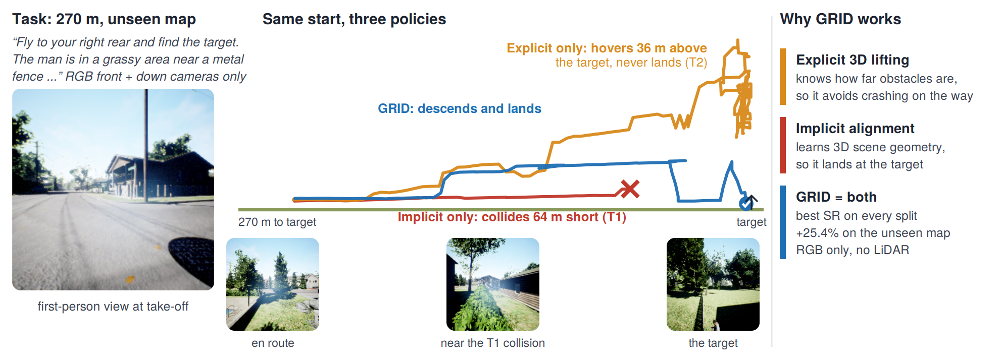
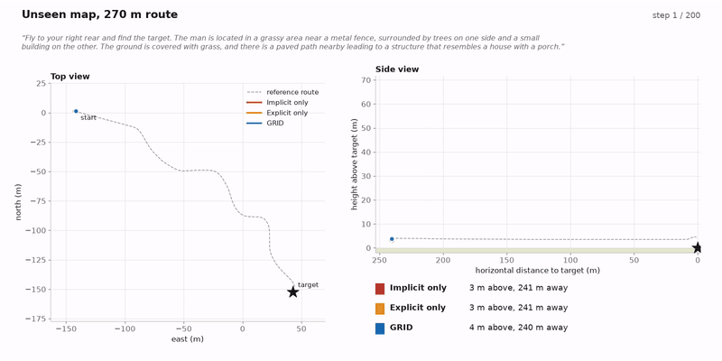
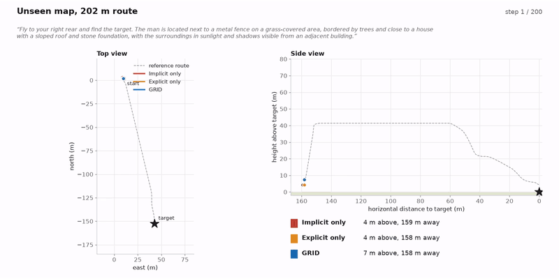
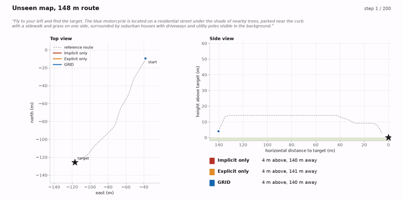
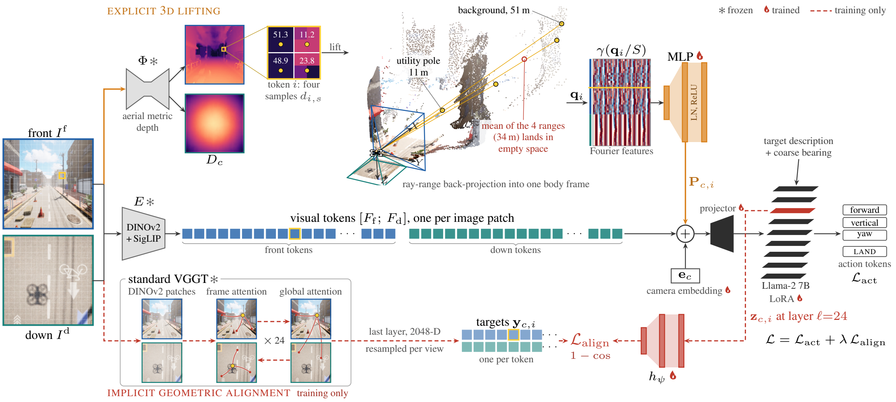

# GRID: Geometry and Ray-Depth Integrated Decision-making for Unmanned Aerial Vehicles

<p align="center">
  <a href="https://arxiv.org/abs/2611.23491"></a>
  <a href="https://github.com/anas2908/GRID-UAV/releases/tag/v1.0"></a>
</p>

**Paper:** [arxiv.org/abs/2611.23491](https://arxiv.org/abs/2611.23491)

<p align="center">
  
</p>

**Flight videos on the unseen map.** Top and side views of the flight paths; the star marks the target.

<p align="center">
  <br>
  <em>270 m route: the man by a metal fence</em>
</p>

<p align="center">
  <br>
  <em>202 m route: the man next to a fence</em>
</p>

<p align="center">
  <br>
  <em>148 m route: the blue motorcycle</em>
</p>

**Failure case.** [Video](docs/assets/videos/failures/failure_1.gif) of an unseen-map episode in which GRID sends LAND before reaching the 20 m success radius.

GRID is a vision-language-action policy for aerial vision-language navigation that sees the world only through a forward and a downward RGB camera. It grounds the policy in 3D in two complementary ways:

1. **Ray-depth lifting.** An aerial metric depth model estimates the range along each pixel ray in both cameras. Every visual token is placed at its 3D position in the UAV body frame, and these positions are added to the tokens through a Fourier-feature MLP.
2. **Geometric alignment (training only).** The policy's visual tokens at layer 24 of the language model are aligned with the features of a frozen VGGT. The alignment head is discarded after training, so it adds nothing at inference.

The policy is built on OpenVLA-7B with LoRA. It outputs discrete forward, vertical and yaw commands, plus a `LAND` token.

<p align="center">
  
</p>

## Contents

- [Quick start](#quick-start)
- [Installation](#installation)
- [Checkpoints](#checkpoints)
- [Data and simulator](#data-and-simulator)
- [Evaluation](#evaluation)
- [Training from scratch](#training-from-scratch)
- [Repository layout](#repository-layout)
- [Results](#results)
- [License and acknowledgements](#license-and-acknowledgements)

## Quick start

On a Linux machine with a CUDA GPU (about 20 GB of memory) and Python 3.10:

```bash
git clone https://github.com/anas2908/GRID-UAV.git && cd GRID-UAV && bash scripts/quickstart.sh
```

The script does four things:

1. Installs the package (and PyTorch 2.1.2 for CUDA 11.8 if PyTorch is missing).
2. Downloads the GRID weights.
3. Fetches OpenVLA-7B from Hugging Face.
4. Runs one inference step on the example frames in `docs/assets/example/`.

Expected output:

```text
output:  <three action bins> [LAND]
action:  forward ... m, down ... m, yaw ... rad, land ...
depth:   front median ... m, down median ... m
```

The policy can be called on your own frames from Python:

```python
from PIL import Image
from grid.actions import navigation_prompt
from grid.policy import GRIDPolicy

policy = GRIDPolicy("checkpoints/grid")
front, down = Image.open("front.png"), Image.open("down.png")
prompt = navigation_prompt("forward-left ", "The white truck is parked on a residential street.")
print(policy.generate(policy.prepare(front, down, prompt)))
```

Front and down images must be 256×256 RGB, as rendered by the TravelUAV simulator. The hint is one of the coarse bearings used in training: `straight ahead`, `forward-left`, `forward-right`, `to your left`, `to your right`, `to your left rear` or `to your right rear`.

## Installation

```bash
conda create -n grid python=3.10 -y
conda activate grid
pip install torch==2.1.2 torchvision==0.16.2 --index-url https://download.pytorch.org/whl/cu118
pip install -e .            # inference
pip install -e ".[train]"   # adds VGGT, needed only for training
```

`flash-attn` is optional. Closed-loop evaluation needs the AirSim client and the simulator harness, which `bash scripts/setup_eval.sh` installs (see [Evaluation](#evaluation)).

## Checkpoints

| File | Size | Description |
|---|---|---|
| `policy/adapter_model.safetensors` | 473 MB | LoRA (r = 64) and projector weights, including the 3D position MLP and camera embedding |
| `policy/adapter_config.json` | 1 KB | PEFT configuration |
| `depth/aerial_depth.pt` | 1.3 GB | Aerial metric depth model Φ (Depth Anything V2 Large, fine-tuned on TravelUAV) |

```bash
bash scripts/download_weights.sh checkpoints/grid
```

The pretrained backbone, [`openvla/openvla-7b`](https://huggingface.co/openvla/openvla-7b), is downloaded automatically at a pinned revision.

## Data and simulator

All data comes from the public [TravelUAV](https://github.com/prince687028/TravelUAV) benchmark (UAV-Need-Help task). The training trajectories are the curated set of 7,611 trajectories and 410,450 frames released with [AeroVLA](https://huggingface.co/XuPeng23/AerialVLA).

```bash
bash scripts/download_data.sh data   # training manifest, TravelUAV archives and simulator binaries
bash scripts/prepare_data.sh data     # extracts the archives to data/dataset_raw and builds merged_data.json
```

After these steps, `data/` contains:

```text
data/
├── aerovla_train_dataset.json   # training manifest (410,450 rows)
├── traveluav_zips/              # downloaded split archives (can be removed after extraction)
├── dataset_raw/                 # <Map>/<trajectory>/{frontcamera,downcamera,...}/000123.png, log/, merged_data.json
└── envs/                        # Unreal Engine scenes: carla_town_envs/, closeloop_envs/, extra_envs/
```

The full TravelUAV download is about 480 GB, and the simulator scenes are another 84 GB. If disk space is short, extract only the front and down images that training uses:

```bash
python -m grid.prepare_data --manifest data/aerovla_train_dataset.json \
    --archives data/traveluav_zips --output data/dataset_raw --with-depth
```

`7z` must be installed for the multi-part archives (`apt install p7zip-full`).

## Evaluation

Closed-loop evaluation uses the TravelUAV AirSim interface as released with AeroVLA, fetched at a fixed commit. The test set is the official one: 3,005 episodes split into Seen (1,418), Unseen Object (629) and Unseen Map (958).

```bash
bash scripts/setup_eval.sh                       # harness, AirSim client and test splits
WEIGHTS=checkpoints/grid bash scripts/eval.sh    # all splits; writes eval_results/grid
```

`scripts/eval.sh` starts the simulator server on `GPU` (default 0) and `PORT` (default 30000), runs every map of every split, and then prints SR, OSR, NE and SPL for the Full, Easy and Hard subsets. To run some splits only, set `SPLITS`, for example `SPLITS=unseen_map_valset`. Per-map results go to `eval_results/grid/metrics_per_map.csv`.

All numbers below were obtained on headless GPUs (no attached display), as is typical on clusters.

## Training from scratch

The full pipeline is three stages. The commands below assume 4 GPUs (A100 40 GB); set `GPUS` to change this. The global batch size stays fixed and gradient accumulation is adjusted automatically.

**1. Aerial depth model Φ** (optional; the released Φ can be used instead).

This stage fine-tunes Depth Anything V2 Large (metric, Virtual KITTI) on TravelUAV's ground-truth depth for the front and down cameras:
- SiLog loss
- learning rate 5e-5 for the head and 5e-6 for the encoder
- 3 epochs at a batch of 16 frame pairs
- trajectory-level 80/10/10 split

```bash
bash scripts/train_depth.sh      # writes checkpoints/aerial_depth/aerial_depth.pt
```

**2. Depth cache.** This runs Φ once on every training frame and stores 64×64 range maps in a 6.7 GB float16 array.

```bash
DEPTH=checkpoints/grid/depth/aerial_depth.pt bash scripts/build_depth_cache.sh
```

**3. Policy.** This starts from OpenVLA-7B, trains LoRA (r 64, α 128), the projector, the 3D position MLP and the camera embedding, and adds VGGT alignment with weight 0.5:
- 5 epochs (32,065 steps)
- batch 64
- learning rate 2e-4, cosine schedule

```bash
bash scripts/train_grid.sh       # writes checkpoints/grid_train/final
```

To evaluate the result, copy `checkpoints/grid_train/final` to `checkpoints/grid/policy`.

## Repository layout

```text
GRID-UAV/
├── grid/
│   ├── model.py              # two-view encoder, 3D position embedding, projector
│   ├── geometry.py           # ray-range back-projection into the body frame
│   ├── alignment.py          # VGGT teacher, alignment head and loss
│   ├── depth.py              # aerial metric depth model Φ
│   ├── actions.py            # action tokens, prompts, coarse bearing
│   ├── data.py               # training dataset and collator
│   ├── policy.py             # inference wrapper
│   ├── train.py              # policy training
│   ├── build_depth_cache.py
│   ├── prepare_data.py
│   └── demo.py
├── dav2_finetune/train.py    # fine-tuning of Φ
├── eval/                     # closed-loop evaluation and metrics
├── scripts/                  # one script per step above
├── third_party/              # Depth Anything V2 model code
└── docs/assets/
```

## Results

TravelUAV test set, 3,005 episodes, headless evaluation. SR, OSR and SPL are in %, NE is in meters.

| Split | Episodes | SR | OSR | NE | SPL |
|---|---:|---:|---:|---:|---:|
| Seen | 1,418 | 48.03 | 56.35 | 68.83 | 38.15 |
| Unseen Object | 629 | 56.76 | 61.37 | 68.32 | 46.71 |
| Unseen Map | 958 | 42.69 | 59.39 | 58.14 | 31.77 |

## License and acknowledgements

The code is released under the Apache 2.0 license (see `LICENSE`). The released weights inherit the terms of the models they are built on:
- [OpenVLA](https://github.com/openvla/openvla), whose base is Llama 2
- [Depth Anything V2 Large](https://github.com/DepthAnything/Depth-Anything-V2) (CC BY-NC 4.0): Φ is fine-tuned from it, so the Φ weights may be used for non-commercial purposes only
- [VGGT](https://github.com/facebookresearch/vggt), used during training only

We thank the authors of [TravelUAV](https://github.com/prince687028/TravelUAV), [AeroVLA](https://github.com/XuPeng23/AeroVLA), [OpenVLA](https://github.com/openvla/openvla), [Depth Anything V2](https://github.com/DepthAnything/Depth-Anything-V2), [VGGT](https://github.com/facebookresearch/vggt), [SpatialVLA](https://github.com/SpatialVLA/SpatialVLA) and [Spatial Forcing](https://github.com/OpenHelix-Team/Spatial-Forcing) for releasing their code, models and data.
